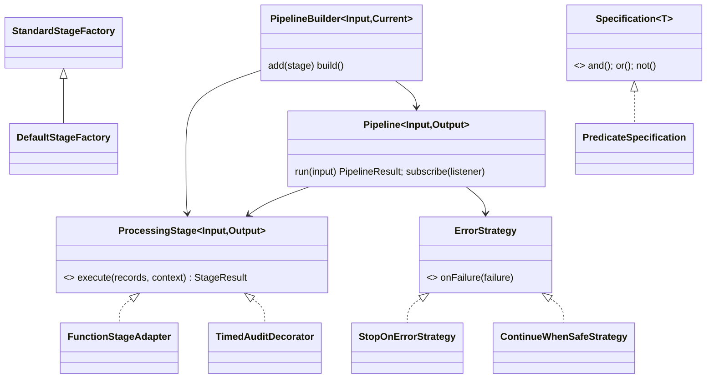
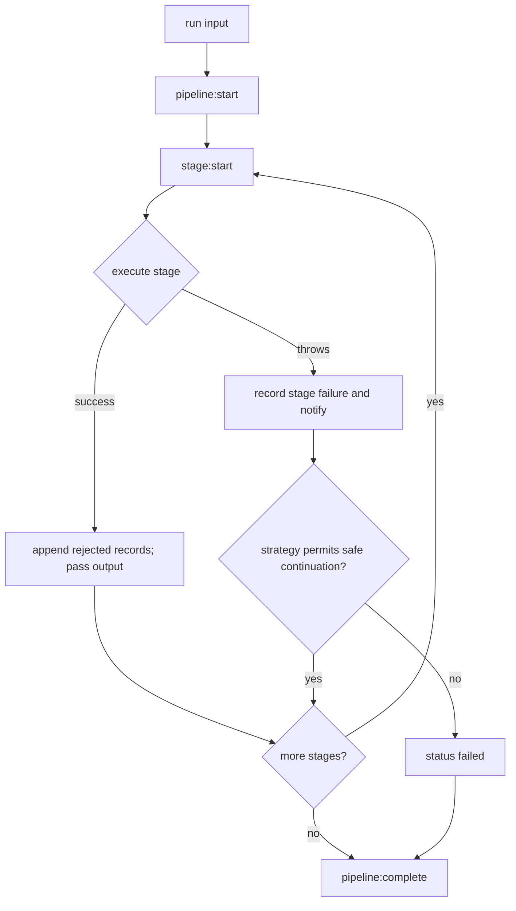

# Arquitetura FlowForge

## Contratos e fluxo

`ProcessingStage<Input, Output>` é o contrato público Command. `execute` recebe uma coleção e contexto, devolvendo registros da saída tipada e, opcionalmente, rejeitados. Uma operação de transformação altera o tipo de saída; validação e filtro preservam o tipo e reportam recusados; decorators acrescentam efeitos observáveis sem trocar os registros.

## Decisões

- A execução é sequencial e assíncrona, dando uma ordem determinística aos eventos.
- A estratégia continua apenas se a etapa declara a segurança. Nesse caminho, os dados de entrada anteriores são preservados. Falhas permanecem em `failures`; status permanece `failed` mesmo se etapas posteriores rodarem.
- Erros de listeners são preservados em `listenerFailures` e um evento `listener:failure` é oferecido aos observadores. Se o próprio observador desse evento falhar, a falha é acumulada sem recursão infinita.
- Cada chamada a `run` tem estado local e identificador distinto. As operações padrão não alteram os registros recebidos.
- `StandardStageFactory` define métodos de criação protegidos e sobrescrevíveis para validação, normalização e deduplicação; subclasses especializam a criação sem alterar consumidores.
- A licença e os integrantes são campos pendentes; nenhum dado foi fabricado.

## Alternativas consideradas e limites

Um pipeline síncrono reduziria complexidade, mas impediria etapas assíncronas e sinks de auditoria assíncronos. A execução em paralelo foi deixada de fora para manter ordenação e semântica de falha explicáveis. Não há rollback de efeitos externos. O sinal `safeToContinueAfterFailure` é uma declaração do autor da etapa e deve ser usado com cuidado.

## Guia de extensão

Implemente `ProcessingStage<I, O>` em seu projeto consumidor e passe a instância a `createPipeline<I>().add(stage)`. `examples/consumer/custom-stage.mjs` demonstra consumo pelo pacote após build/pack. Nenhum registry interno precisa ser alterado.

## Matriz de rastreabilidade

| Requisito/padrão | Código                          | Teste                             | Exemplo                             | Evidência                                              |
| ---------------- | ------------------------------- | --------------------------------- | ----------------------------------- | ------------------------------------------------------ |
| Builder          | `src/core/pipeline.ts`          | construção vazia e integração     | `examples/sales.ts`                 | adiciona etapas progressivamente e valida build        |
| Command          | `src/core/contracts.ts`         | adaptador e falha de etapa        | `examples/consumer/custom-stage.ts` | executor invoca contrato sem depender do tipo concreto |
| Strategy         | `src/core/strategies.ts`        | continuar seguro e parar inseguro | pipeline de vendas                  | estratégias produzem decisões diferentes               |
| Observer         | `src/core/pipeline.ts`          | listener lança exceção            | `examples/sales.ts`                 | inscrição, notificação e remoção                       |
| Decorator        | `src/patterns/decorators.ts`    | resultado/auditoria               | `examples/sales.ts`                 | mede duração e mantém resultado original               |
| Factory Method   | `src/patterns/factory.ts`       | criação do validador              | `examples/sales.ts`                 | método protegido substituível em subclasses            |
| Adapter          | `src/patterns/adapter.ts`       | execução de função adaptada       | testes                              | adapta função sync/async ao contrato                   |
| Specification    | `src/patterns/specification.ts` | AND/OR/NOT                        | `examples/sales.ts`                 | regra reutilizável e composições                       |
